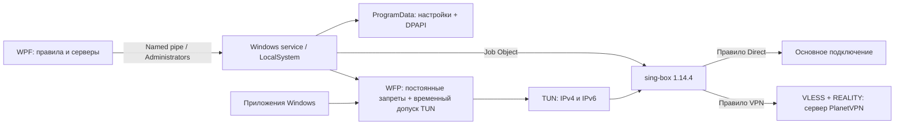

# Архитектура

Смена конфигурации сначала закрывает временный допуск. Новые защищаемые приложения блокируются до записи настроек. Изменение WFP выполняется транзакцией; при ошибке записи более строгий набор блокировок остаётся. Подключение считается готовым после HTTPS-проверки через отдельный аутентифицированный loopback SOCKS-вход, который всегда направлен в выбранный VPN-транспорт. Первая проверка выполняется без общего TUN; вторая — после его запуска. Отключённая служба не запускает сетевой движок. OpenVPN работает с route-nopull/route-noexec на отдельном интерфейсе; sing-box привязывает VPN-сокеты к нему. Прямые соединения привязаны к физическому интерфейсу.

Управляющий API допускает команды `status`, `save`, `import`, `select-server`, `select-protocol`, `refresh`, `connect`, `disconnect`. Кадры JSON ограничены 5 MiB, импорт — 4 MiB; изменения сериализуются; подключение выполняется в отменяемой фоновой задаче. Статус доступен во время попыток. Остановка службы через SCM отменяет подключения независимо от named pipe. Ответы содержат только метаданные серверов. `select-server` атомарно сохраняет ID отдельно от редактируемых в UI правил.

Блокировки находятся на ALE_AUTH_CONNECT и ALE_AUTH_RECV_ACCEPT для обеих версий IP. Совпадение по ALE_APP_ID использует нормализованный Unicode NT-путь. В одном sublayer временное разрешение приложения на IP_LOCAL_INTERFACE TUN имеет больший вес, чем постоянный запрет. Разрешение не устанавливает CLEAR_ACTION_RIGHT и не предназначено для обхода других системных брандмауэров.

FakeIP позволяет не угадывать домен по общему CDN-адресу. Его таблица сохраняется в защищённом `cache.db`. При смене движка очищается системный DNS-кэш. Загрузка состояния с ошибкой не удаляет уже установленные постоянные фильтры.

Официальные источники:

- [sing-box: TUN](https://sing-box.sagernet.org/configuration/inbound/tun/)
- [sing-box: правила](https://sing-box.sagernet.org/configuration/route/rule/)
- [sing-box: VLESS](https://sing-box.sagernet.org/configuration/outbound/vless/)
- [Microsoft: WFP lifetime and transactions](https://learn.microsoft.com/en-us/windows/win32/fwp/object-management)
- [Microsoft: filter arbitration](https://learn.microsoft.com/en-us/windows/win32/fwp/filter-arbitration)
